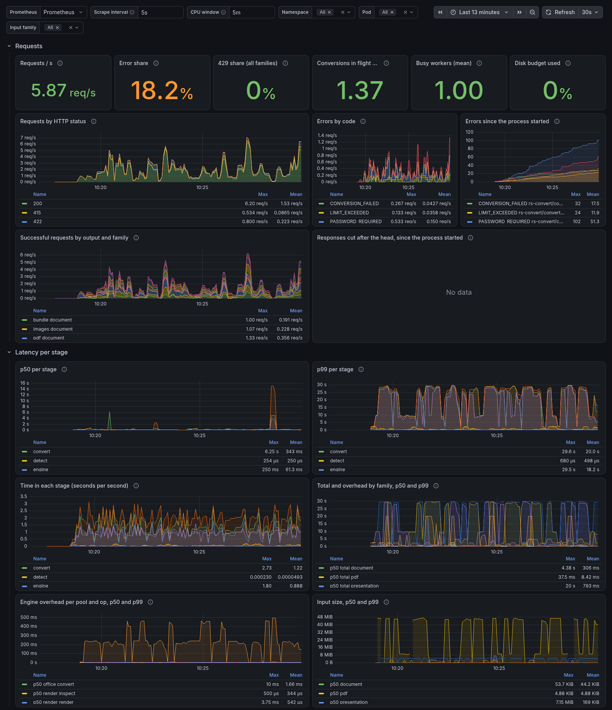

# convertd

[](https://pkg.go.dev/github.com/viktordanov/convertd/client)
[](https://github.com/viktordanov/convertd/pkgs/container/convertd)
[](api/openapi.json)
[](https://github.com/viktordanov/rs-memoria)
[](https://github.com/viktordanov/convertd/actions/workflows/memoria.yml)

convertd is an HTTP service that converts office documents and PDFs into a PDF and per-page images.

**Status: the service converts office documents and PDFs. Version 0.3.0 is published as the container image `ghcr.io/viktordanov/convertd`, for linux/amd64 and linux/arm64.** `convertd serve` runs LibreOffice and PDFium in pools of worker processes. The quick start runs this image, and a build from source with a fake engine. The API is version `1.0.0`.

## Contents

1. [The problem](#the-problem)
2. [What it does not do](#what-it-does-not-do)
3. [Quick start](#quick-start)
4. [The API](#the-api)
5. [Deployment](#deployment)
6. [Observability](#observability)
7. [Boundaries](#boundaries)
8. [Documentation](#documentation)
9. [License](#license)

## The problem

A service that converts office files with `soffice --convert-to` starts a new LibreOffice process for each file. A warm LibreOfficeKit instance converted small files 3 to 6 times faster than a cold `soffice` process, on an Apple-silicon laptop with a synthetic corpus ([docs/m0-spikes.md](docs/m0-spikes.md)).

LibreOffice and PDFium also parse files from callers that the service does not control. A file that hangs or crashes a parser must not stop the service.

convertd keeps LibreOffice loaded in long-lived worker processes through LibreOfficeKit, and it renders pages with PDFium. Each engine runs in a worker process that the supervisor can kill at a deadline and replace. It is one Rust binary in one image. It has no database and no job store.

## What it does not do

The service has a narrow scope:

- It does no OCR, text extraction or layout analysis.
- It does not convert HTML, web pages or email (`.eml`, `.msg`).
- It does not guarantee that its output matches Microsoft Office. LibreOffice lays out each document, and the layout can differ from Word or PowerPoint.
- It has no asynchronous jobs, webhooks or result storage. Each call is synchronous, and the caller owns retries.
- It does not edit PDFs: no merge, split, signature or PDF/A.
- Version 1 does not convert image files. A PNG, JPEG, TIFF, GIF, BMP or WebP upload gets `415 UNSUPPORTED_FORMAT`.

<!-- memoria:section id="setup" files="Cargo.toml rust-toolchain.toml" -->
## Quick start

The quick start has two paths. The container image runs the real engines and needs Docker. A build from source runs a fake engine in place of LibreOffice and PDFium, and needs only Rust.

### The container image

The image is on GHCR for linux/amd64 and linux/arm64. These commands ran on an Apple-silicon Mac (linux/arm64) with a Docker VM of about 4 GB.

1. Pull the image:

   ```bash
   docker pull ghcr.io/viktordanov/convertd:0.3.0
   ```

   To build it yourself instead, run `docker buildx build -f docker/Dockerfile --target runtime --build-arg CARGO_JOBS=4 --load -t convertd:local .` from the repository root, and use `convertd:local` in the next step. [docker/README.md](docker/README.md) gives the other targets and the build arguments.

2. Start the image with a read-only root and a writable `/tmp`. One office worker and two render workers keep the run small. The defaults are half of the CPUs and all of the CPUs:

   ```bash
   docker run -d --name convertd --read-only --tmpfs /tmp:size=2g --cap-drop ALL --security-opt no-new-privileges \
     -e API_KEY=dev-key -e OFFICE_WORKERS=1 -e RENDER_WORKERS=2 -p 127.0.0.1:8080:8080 ghcr.io/viktordanov/convertd:0.3.0
   ```

   This container is on Docker's default network, so it can open outbound connections. The service needs none. For anything beyond a local test, block its egress, as [deploy/README.md](deploy/README.md#worker-isolation) explains.

3. Wait until `curl -sS http://127.0.0.1:8080/readyz` shows `"status":"ready"`. In the run on the Mac, this took about 1 s.

4. Send a DOCX of your own:

   ```bash
   curl -sS -D - -o out.pdf -H "Authorization: Bearer dev-key" -F file=@report.docx http://127.0.0.1:8080/v1/convert
   ```

5. Stop and remove the container:

   ```bash
   docker stop convertd && docker rm convertd
   ```

Next: read [The API](#the-api) for the page images and the bundle.

### From source, with the fake engine

You need a Linux or macOS host with rustup. `rust-toolchain.toml` pins Rust 1.99.0, and rustup installs it on the first build. The test command uses [cargo-nextest](https://nexte.st).

1. Build `convertd` with the test hooks:

   ```bash
   cargo build --features test-hooks
   ```

2. Run the tests:

   ```bash
   cargo nextest run --features test-hooks
   ```

3. Start the server with the fake engine. `HOST=127.0.0.1` keeps it on the loopback interface, and it listens on port 8080:

   ```bash
   API_KEY=dev-key HOST=127.0.0.1 TEST_ENGINE=fake target/debug/convertd serve
   ```

4. In a second terminal, send a PDF of your own:

   ```bash
   curl -sS -D - -o out.pdf -H "Authorization: Bearer dev-key" -F file=@report.pdf http://127.0.0.1:8080/v1/convert
   ```

The fake engine returns a PDF unchanged and turns an office file into a one-page placeholder PDF. Detection, validation and the response headers come from the real request path. This response leaves out the `content-length` and `date` lines:

```text
HTTP/1.1 200 OK
content-type: application/pdf
content-disposition: attachment; filename="report.pdf"; filename*=UTF-8''report.pdf
convert-source-format: pdf
convert-page-count: 1
convert-warning-count: 0
convert-engine-fingerprint: sha256:62666a78c776
server-timing: recv;dur=0.978, detect;dur=0.006, queue;dur=0.000, lease;dur=0.000, spawn;dur=0.000, bind;dur=0.000, inspect;dur=0.134, inspect_engine;dur=0.000, probe_engine;dur=0.000, verify;dur=0.000, package;dur=0.012, total;dur=0.165
x-request-id: df997c7b55784260b1bbdf216c48ba0d
```

`TEST_ENGINE` works only in a build with the `test-hooks` feature, and the image never has it. Next: read [tests/README.md](tests/README.md) for the other test commands.
<!-- /memoria:section -->

<!-- memoria:section id="usage" files="api/openapi.json" -->
## The API

One endpoint does the work. `POST /v1/convert` takes a multipart upload with a `file` part and an optional `options` part in JSON. The service detects the format from the bytes, never from the file name.

The `output` option selects the response: the PDF (`pdf`, the default), the page images (`images`), or the PDF and the page images (`bundle`). The service sends `images` and `bundle` as a tar archive in one zstd frame: `application/zstd`, named `<stem>.tar.zst`. The archive starts with a `manifest.json` that describes the pages and the warnings. In a bundle, `document.pdf` comes next. The pages follow as `pages/NNNN.<ext>`.

This call returns the PDF and JPEG page images at 150 DPI in one archive:

```bash
curl -sS -H "Authorization: Bearer $CONVERT_API_KEY" \
  -F file=@deck.pptx \
  -F 'options={"output":"bundle","images":{"format":"jpeg","dpi":150}};type=application/json' \
  -o deck.tar.zst \
  "$CONVERT_HOST/v1/convert"
```

`zstd -dc deck.tar.zst | tar -tf -` lists the entries. Legacy binary Office files (`.doc`, `.xls`, `.ppt`, `.pps`) go to LibreOffice, as OOXML files do. An encrypted file without the `password` option gets `422 PASSWORD_REQUIRED`.

Every `/v1` route needs the API key as a bearer token. The probes (`/healthz`, `/readyz`) and `/metrics` take no key. `GET /v1/capabilities` lists the formats, the limits and the engine versions of a deployment.

`convertd openapi` emits the OpenAPI 3.1 spec. The repository holds its output as [api/openapi.json](api/openapi.json), and the server serves the same bytes at `/swagger/doc.json`. `generate.sh` generates the Go client from this file. The committed file is the contract. `generate.sh --check` fails when the spec that `convertd openapi` emits differs from it. `speccheck validate`, in `client/contract/`, checks its structure, its examples and the rules of the project for the spec.
<!-- /memoria:section -->

## Deployment

The image runs on any container platform with a read-only root, a writable `/tmp`, the probes on `/readyz` and `/healthz`, and a termination grace longer than `SHUTDOWN_GRACE_SECONDS`. The service opens no outbound connections, so block its egress. [deploy/README.md](deploy/README.md) gives the reasons for each setting.

- **Kubernetes:** `deploy/k8s/base` is a kustomize base with a Deployment, a Service and a NetworkPolicy that blocks egress. `deploy/k8s/overlays/gvisor` runs the pods under gVisor. Point an overlay of your own at `ghcr.io/viktordanov/convertd:0.3.0`.
- **Docker or another platform:** start from the quick start's `docker run` line, and block the container's egress.
- **Sizing:** LibreOffice needs the memory. An office worker used 462 MiB at p50 and 1546 MiB at p99 on a set of 276 office files and PDFs. The [memory budget](deploy/README.md#memory-budget) gives the rule for the per-pool limits, and the values for 2 CPUs and 4 GiB.

## Observability

convertd serves Prometheus metrics on `GET /metrics`, without the API key: requests by error code, the time of each stage, the queue, the workers, memory, disk and CPU per job. `deploy/observability/` holds a Grafana dashboard and a `PrometheusRule` with four alerts. [deploy/README.md](deploy/README.md#observability) explains both.



The image shows the top of the dashboard during 11 minutes of conversions of the test corpus, two at a time, against the `0.2.0` image with 1 office worker and 2 render workers. The corpus includes files that fail on purpose, so 18 % of the requests are errors: encrypted files without a password and files that LibreOffice cannot load (422), and an image upload (415).

## Boundaries

Each folder in this list has a README for its own readers.

### Using the service

- [client/README.md](client/README.md) covers the Go client: a hand-written facade over a client generated from the spec.

### Deploying it

- [docker/README.md](docker/README.md) covers the image: the pinned LibreOffice, PDFium and fonts, and the build targets.
- [deploy/README.md](deploy/README.md) covers the Kubernetes manifests, the settings that any container platform needs, and the example Grafana dashboard and Prometheus alerts. `tools/observability/gen_dashboard.py` generates the dashboard.
- `build_docker.sh` builds the image for linux/amd64 and linux/arm64 and pushes it to a repository that you name.
- A tag `vX.Y.Z` runs `.github/workflows/release.yml`. It builds and tests the image on both architectures, publishes it to GHCR as `ghcr.io/<owner>/convertd`, and creates a GitHub release. [docker/README.md](docker/README.md#releases) describes it.

<!-- memoria:section id="contributing" files="generate.sh scripts/contract_test.sh .github/workflows/image.yml .github/workflows/corpus.yml .config/nextest.toml" -->
### Contributing to it

- [src/README.md](src/README.md) covers the `convertd` crate: its process model and its layers.
- [tests/README.md](tests/README.md) covers the test levels, the two fakes, the nextest profiles and the commands that CI runs.
- [corpus/README.md](corpus/README.md) covers the generated test corpus and the expected result for each file. When a change touches `corpus/`, `.github/workflows/corpus.yml` regenerates the corpus on Linux and compares every file with its pinned hash.
- [tools/corpus/README.md](tools/corpus/README.md) covers `corpus-bench`, the tool that checks the corpus and its expectations.
- `tools/ingest/` sends a folder of your own documents through a running image under fixed limits, and samples the memory of every worker. Each script's header gives its usage. Its results stay outside the repository.
- `generate.sh` emits the spec with `convertd openapi`, regenerates the Go client from it and tests the client. `scripts/contract_test.sh` runs the contract tests against a real `convertd`.
- `.github/workflows/security.yml` checks the dependency advisories on every pull request and weekly. `cargo deny check advisories` reads the RustSec database for the crates, with the rules in `deny.toml`. `govulncheck` reads the Go vulnerability database for `client/` and for `client/contract/`, with the newest patch of the Go line that `client/go.mod` names.
- Every push and pull request runs `memoria check` (`.github/workflows/memoria.yml`). The check fails while a README waits for review after a change to its sources. [Memoria in this repository](docs/documentation/memoria.md) gives the review steps.
<!-- /memoria:section -->

## Documentation

[docs/README.md](docs/README.md) maps the other documents: the engine measurements, the writing guidance and the architecture diagram.

`bench/results/` holds the benchmark records. In [2026-11-26.md](bench/results/2026-11-26.md), the service added 0.88 ms at p50 to the conversion of a one-page DOCX to PDF, beside 22.7 ms in LibreOffice. That run used the arm64 image on an Apple-silicon Mac, with 4 CPUs for the container. `examples/overhead.rs` produces these numbers: `src/README.md` explains it.

## License

convertd uses the Apache-2.0 license (`LICENSE`). The image also bundles LibreOffice (MPL-2.0), PDFium (BSD-style) and fonts under their own licenses.
